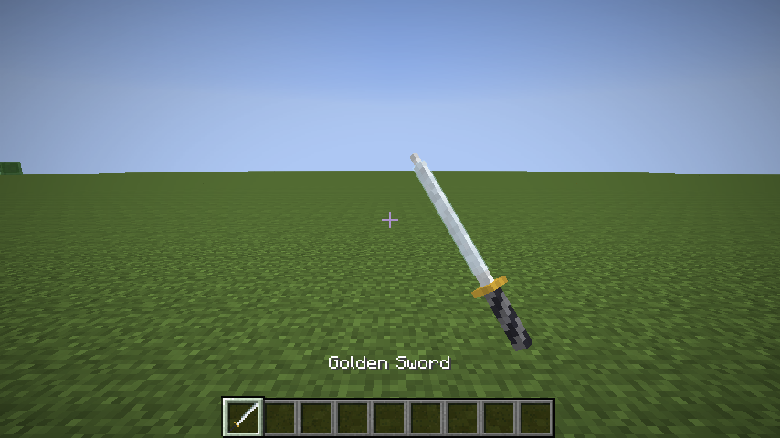
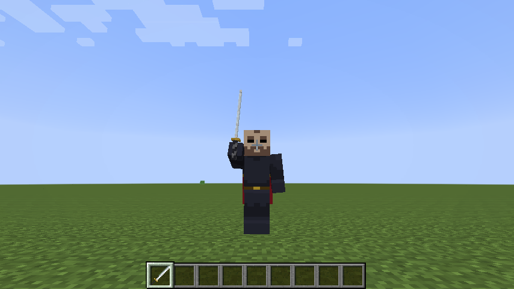
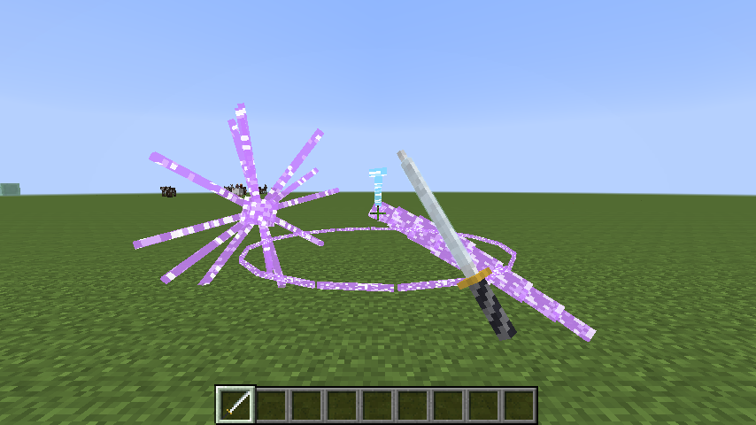
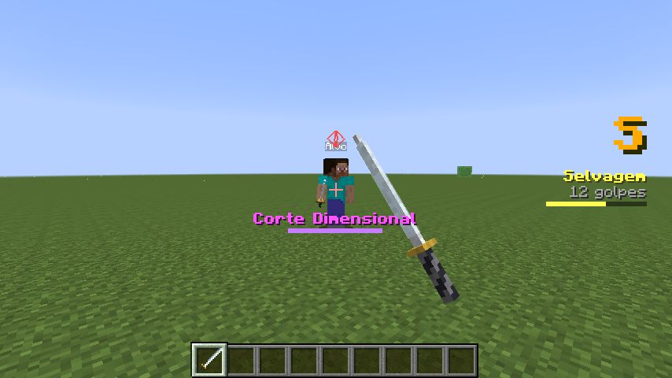

# Overkill

Lâminas no estilo **SlashBlade** e combate **hack'n'slash** (combos, slash arts, espadas invocadas, rank de estilo)
para o **Minecraft 1.7.10**, como **plugin Bukkit** (Thermos/Crucible) + **resource pack**, por cima do mod
[Künftig](https://github.com/Akashiic/Kunftig) (API 9) e do **GeckoLib Unofficial 1.0.4** no cliente.

O servidor decide tudo: dano, combos, slash arts, rank. O cliente com Künftig desenha a katana em 3D, prevê o golpe
no instante do clique e mostra HUD, efeitos e trava de câmera. Quem entra sem o Künftig vê a espada vanilla e as
partículas dos cortes, e o combate funciona igual.

## O que tem

| Mecânica | Como funciona |
|---|---|
| **Lâminas** | Configuráveis em `blades.yml`. Cada item guarda abates, proud soul, refino e desgaste (dados persistentes do Künftig). Três lâminas de fábrica: Katana, Lâmina Rubra e Tempestade |
| **Combo** | Clique esquerdo. Quatro golpes no chão; correndo, uma investida; agachado, um lançador; no ar, três golpes aéreos que mantêm o alvo no ar; agachado no ar, uma queda. Atacar enquanto saca é um **iaido** (saque rápido, dano dobrado) |
| **Slash Art** | Segure o botão direito (a guarda da espada) até carregar e solte. **Corte Dimensional** (rajada de cortes onde você olha ou no alvo travado), **Onda Cortante** (projétil) ou **Corte Circular** (giro em volta). Custa proud soul |
| **Espadas invocadas** | Tecla **Especial** (R). Três espadas teleguiadas até o alvo |
| **Esquiva** | Tecla **Esquiva** (Alt esquerdo). Corrida curta na direção das teclas de movimento, com alguns ticks de invulnerabilidade. Esquivar no tempo certo dá estilo |
| **Truque aéreo** | Tecla **Habilidade** (F). Teleporte para o lado do alvo travado |
| **Trava de alvo** | Tecla **Travar alvo** (Z). A câmera segue o alvo e um marcador fica sobre ele |
| **Rank de estilo** | D a SSS no HUD. Sobe com acertos variados, cai quando você apanha e escorre quando você para de lutar. Ranks altos rendem mais proud soul |
| **Progressão** | Abates e proud soul por abate. `/overkill refinar` gasta proud soul e soma dano. Quando quebra, a lâmina corta com 1/4 do dano e não usa Slash Art; `/overkill reparar` conserta |

Referência completa (golpes, quadros, janelas, fórmulas): [`docs/COMBATE.md`](docs/COMBATE.md).

## Capturas

Tiradas num cliente 1.7.10 de verdade pelo harness de desenvolvimento do Künftig (modo `blades`), com a arte
provisória gerada pelo plugin. O relatório das conferências está em [`docs/capturas/relatorio-harness.txt`](docs/capturas/relatorio-harness.txt).

| | |
|---|---|
|  |  |
| Katana 3D em primeira pessoa | `golpe_3` (corte de cima) em terceira pessoa |
|  |  |
| Corte Dimensional, Onda, Corte Circular e espada invocada | Rank no HUD, barra da Slash Art e trava de alvo com marcador |

## Instalação

| Onde | O quê |
|---|---|
| Servidor (Thermos/Crucible 1.7.10) | `mods/`: Künftig **9 ou mais novo** e UniMixins. `plugins/`: `Overkill-<versão>.jar` |
| Cliente | `mods/`: Künftig 9+, UniMixins e GeckoLib Unofficial 1.0.4. Resource pack do Overkill (ou enviado pelo servidor) |

Os dois artefatos saem do CI (Actions) a cada build: **`overkill-plugin`** (o jar) e **`overkill-resourcepack`**
(o zip do pack).

Comandos (`/overkill` ou `/ok`):

| Comando | Quem | O quê |
|---|---|---|
| `/overkill dar <lâmina> [jogador]` | `overkill.admin` | entrega uma lâmina (`katana/basica`, `katana/rubra`, `katana/tempestade`...) |
| `/overkill refinar` | todos | gasta proud soul da lâmina na mão e soma um refino |
| `/overkill reparar` | todos | gasta proud soul e zera o desgaste |
| `/overkill info` | todos | estatísticas da lâmina na mão, rank e se o cliente tem as teclas do Künftig |
| `/overkill recarregar` | `overkill.admin` | relê `config.yml` e `blades.yml` |

As teclas ficam em **Controles → Kunftig** e podem ser trocadas lá.

## Arquitetura

```
 Overkill (plugin)  --compileOnly-->  kunftig-api (API 9)
   core/   regras puras e testadas: golpes, combos, máquina de combo, geometria do corte, rank, carga, lâminas
   bukkit/ eventos, dano, itens, slash arts, teclas, HUD, comandos
   tools/  gerador do resource pack (a partir do mesmo core)
        |
 Thermos/Crucible 1.7.10 + mods/kunftig (UniMixins)
        |  kunftig:rod (estado da lâmina), kunftig:display (efeitos), kunftig:hud, kunftig:camera,
        |  kunftig:input (teclas, cliente -> servidor)
 cliente 1.7.10: Künftig + GeckoLib + resource pack do Overkill
```

O resource pack é **gerado** a partir das mesmas definições de golpes que o servidor usa
(`./gradlew generatePack`). As janelas de encadeamento do servidor e a previsão do cliente (`ao_atacar`) nunca
divergem: o CI falha se o pack commitado não for o que o código gera. A arte gerada é provisória (programmer art),
para ser trocada no Blockbench. Veja [`docs/PACK.md`](docs/PACK.md).

## Compilar

Com o Künftig ao lado (`../Kunftig`), as fontes da `kunftig-api` são usadas direto:

```bash
./gradlew build
```

Gate de compatibilidade com a API Bukkit 1.7.10 real do Crucible (o jar sai do script do Künftig):

```bash
../Kunftig/scripts/build-legacy-bukkit-api.sh build/legacy-bukkit/bukkit-1.7.10.jar
```

```bash
./gradlew checkLegacyBukkitApi -PlegacyBukkitApi=build/legacy-bukkit/bukkit-1.7.10.jar
```

Outra origem da API: `-PkunftigApiSrc=<pasta api/src/main/java>` ou o `mavenLocal()` (`./gradlew :api:publishToMavenLocal`
no Künftig, com `-PkunftigApiVersion=<versão>`).

> **Atenção (2026-11-06):** depois do estudo do código do SlashBlade, a implementação atual (combo no clique
> esquerdo, golpes e rank inventados, cubos GeckoLib) será substituída por um port fiel do SlashBlade: Resharped.
> Estudo e plano: [`docs/fidelidade/`](docs/fidelidade/README.md).

## Documentos

| Arquivo | Conteúdo |
|---|---|
| [`docs/fidelidade/`](docs/fidelidade/README.md) | **Estudo do código do SlashBlade (Resharped, SB2, DER) e plano de fidelidade** |
| [`docs/COMBATE.md`](docs/COMBATE.md) | Referência das mecânicas: golpes e quadros, slash arts, teclas, rank, fórmulas |
| [`docs/PACK.md`](docs/PACK.md) | Resource pack: o que é gerado, como trocar a arte, como validar |
| [`docs/ESTUDO.md`](docs/ESTUDO.md) | Estudo de viabilidade original e o que virou cada lacuna |
| [`docs/FASE1-DESIGN.md`](docs/FASE1-DESIGN.md) | Design da fase 1 (histórico; a implementação foi além) |
| [`docs/REFERENCIAS.md`](docs/REFERENCIAS.md) | Fontes consultadas |

## Licença

Ainda não escolhida (como o Künftig). Nenhum código nem asset do SlashBlade foi copiado: as mecânicas foram
reimplementadas a partir da descrição pública, e nomes, modelos, animações e texturas são próprios.
