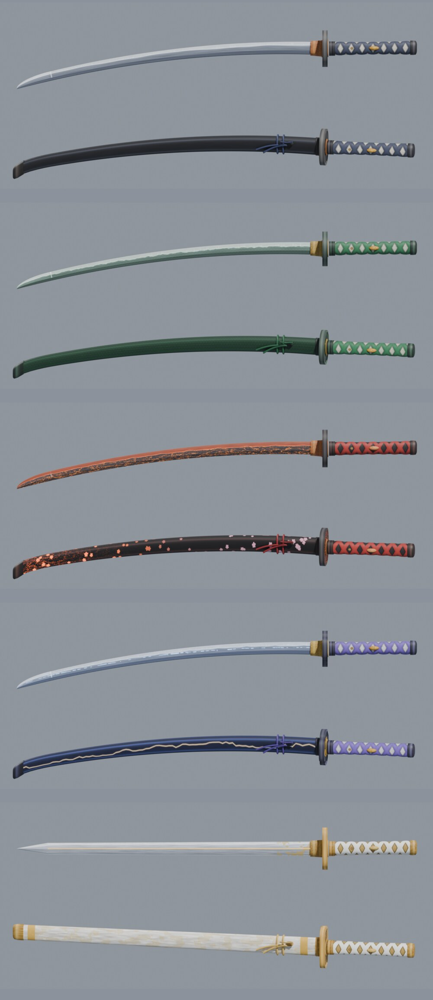
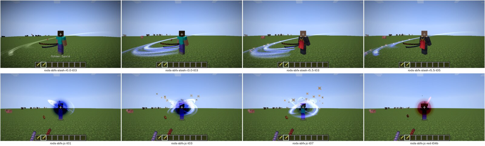
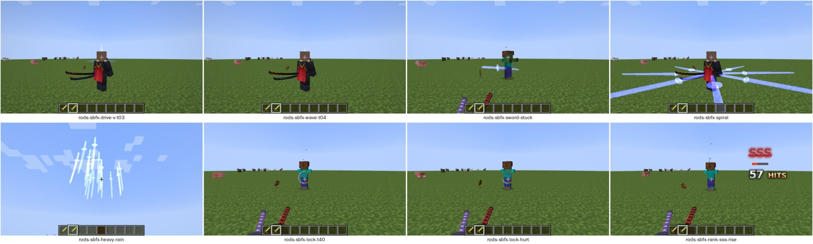
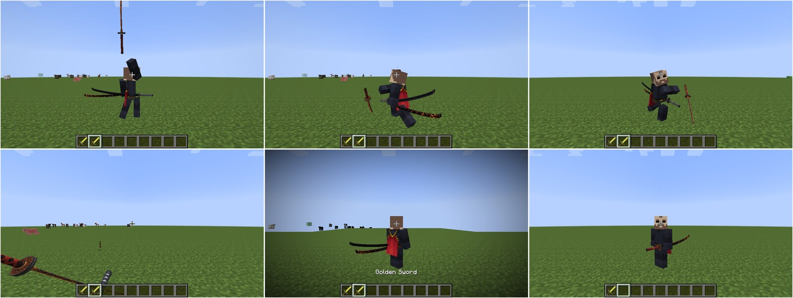
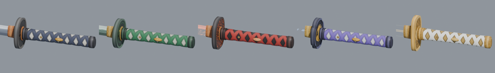
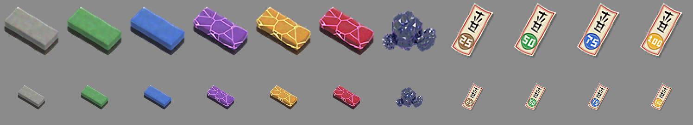

# Overkill

O combate do **SlashBlade** (combos, slash arts, lock-on segurando Sneak, rank de concentração) no **Minecraft
1.7.10**, como **plugin Bukkit** (Thermos/Crucible) + **resource pack**, desenhado pelo mod
[Künftig](https://github.com/Akashiic/Kunftig) (API 11) no cliente. Katanas, efeitos e HUD com **arte própria**.

O servidor decide tudo: a máquina de combo (portada do SlashBlade: Resharped), os acertos, o dano, o knockback, o
stun, as slash arts e o rank. O cliente com Künftig desenha a katana pelo motor de lâminas (OBJ + VMD), o corpo do
jogador, os efeitos (arco do corte, Judgement Cut, ondas, espadas invocadas), a mira do lock-on e o HUD.



## O que tem

| Mecânica | Como funciona (igual ao SlashBlade) |
|---|---|
| **Combo** | **Clique direito** (ou esquerdo em cima de um alvo). Combo A1 → A2 → A3 → A4 (A4ex e A5ex com Força ou Fome); esperar no fim de A2 leva ao C; clicar no fim de A3 abre o combo B (a rajada, até B7). Cada golpe aceita o próximo clique depois da sua janela; um clique adiantado fica guardado e encaixa no menor tempo (memória de clique, como no DmC) |
| **Comandos** | Sneak + frente + clique: **corte de investida** (segurando o botão e acertando: **estrela ascendente**). Sneak + trás + clique: **corte para cima** (segurando trás: **salto**). No ar: **combo aéreo** (A1-A3, ou B3-B4 esperando no fim do A2). No ar com Sneak + trás: **corte descendente** |
| **Slash Art** | Segure o botão direito (9 ticks) e solte: a arte da katana. Soltar logo depois de carregar (ou no instante em que a lâmina embainha) é o **just**: a versão crítica |
| **Lock-on** | **Segure Sneak**: trava no alvo que você olha (ou no mais perto), a câmera puxa para ele e a mira mostra a vida dele. Soltar destrava |
| **Rank** | D a SSS: +30 pontos por acerto, -300 por dano levado, escorre até o piso do nível. Rank alto soma dano e muda o arco do corte. Contador de golpes estilo DmC ao lado |
| **Acertos** | Cada corte acerta por 10 ticks em volta do jogador (alcance 4,5), cada alvo uma vez; ignora a invulnerabilidade do vanilla; knockback do golpe (cancelar, lançar, meteoro, empurrar); stun nos mobs |
| **Progressão** | Como as varas do AkashicFishing: **nível 1 a 99** abatendo (o dano cresce pela curva do refino do SlashBlade), **estrela** sorteada ao empunhar (normal, prata, ouro, irídio) e **fortificação** de +1 a +17 e a **Ascensão** na `/forja`, com pedras de afiar, ofudas de proteção e tamahagane que caem dos inimigos. Almas pagam as Slash Arts e o reparo |

As cinco katanas (`blades.yml`):

| Katana | Slash Art | Cor dos efeitos |
|---|---|---|
| Katana de Aço (inicial) | — | azul |
| Katana da Serpente | Onda Vertical (drive) | verde |
| Katana Sakurajima | Corte Circular | laranja-magma |
| Katana Raijin | Fio da Tempestade (wave edge: cinco ondas) | azul-elétrico |
| Kusanagi no Tsurugi | Corte do Julgamento (Judgement Cut) | dourado |

Referência das mecânicas: [`docs/COMBATE.md`](docs/COMBATE.md); progressão e forja:
[`docs/PROGRESSAO.md`](docs/PROGRESSAO.md). Estudo do código do SlashBlade e plano:
[`docs/fidelidade/`](docs/fidelidade/README.md).

## Capturas

Tiradas num cliente 1.7.10 de verdade pelo harness de desenvolvimento do Künftig.

| | |
|---|---|
|  |  |
| Arco do corte (sem rank, B, SSS) e Judgement Cut | Espadas invocadas, mira do lock-on, HUD SSS com contador |
|  |  |
| Sakurajima no jogo, com o brilho do magma | Os cabos das cinco |



*Pedras de afiar (comum a mítica), tamahagane e ofudas de proteção.*

## Instalação

| Onde | O quê |
|---|---|
| Servidor (Thermos/Crucible 1.7.10) | `mods/`: Künftig **9 ou mais novo** e UniMixins. `plugins/`: `Overkill-<versão>.jar` |
| Cliente | `mods/`: Künftig 9+ e UniMixins. O resource pack do Overkill e, na alfa, o pack com os movimentos (VMD) |

Os artefatos saem do CI a cada build: **`overkill-plugin`** (o jar) e **`overkill-resourcepack`** (o zip).

Comandos (`/overkill` ou `/ok`):

| Comando | Quem | O quê |
|---|---|---|
| `/forja` | `overkill.forja` (todos) | a forja: fortificar e reparar |
| `/overkill dar <lâmina> [jogador] [estrela] [nível] [+N\|asc]` | `overkill.admin` | entrega uma katana (`katana/aco`, `katana/serpente`, `katana/sakurajima`, `katana/raijin`, `katana/kusanagi`) |
| `/overkill pedra <tier\|tamahagane> [qtd] [jogador]`, `/overkill ofuda <25..100> [qtd] [jogador]` | `overkill.admin` | materiais da forja |
| `/overkill info` | todos | o estado do combo da lâmina na mão |
| `/overkill recarregar` | `overkill.admin` | relê `config.yml` e `blades.yml` |

As katanas não têm receita de bancada: por enquanto saem por `/overkill dar`.

As teclas do Künftig ficam em **Controles → Kunftig**.

## Arquitetura

```
 Overkill (plugin)  --compileOnly-->  kunftig-api (API 11)
   combo/          a máquina de combo do SlashBlade, pura e testada: estados, prioridades, janelas, linha do tempo,
                   comandos de raiz, carga e slash arts, rank de concentração
   core/           lâminas e progressão, puras e testadas: nível, estrela, forja (+1..+17, Ascensão), drops
   bukkit/combat/  cliques, botão segurado, efeitos de corte e acertos, dano, knockback, stun, flutuação, lock-on,
                   Judgement Cut, ondas, HUD
   bukkit/         itens (dados persistentes), lâminas (blades.yml), a forja (/forja), trava de receitas, comandos
   tools/          a checagem do resource pack
 arte/             os geradores da arte (Python): katanas e efeitos -> resource pack
        |
 Thermos/Crucible 1.7.10 + mods/kunftig (UniMixins)
        |  kunftig:blade (o que a lâmina toca), kunftig:effect (efeitos, mira, rank, contador),
        |  kunftig:input (teclas seguradas, cliente -> servidor)
 cliente 1.7.10: Künftig + resource pack do Overkill
```

## Arte

Katanas, efeitos e HUD são **nossos**, gerados por código em [`arte/`](arte/): a geometria (lâmina shinogi-zukuri
com kissaki, habaki, tsuba, tsuka com o relevo do ito, saya com sageo), as texturas em 2048x1024 (hamon com nie, hada,
seda sobre pele de arraia, laca) e as camadas que brilham. Veja [`arte/katanas/README.md`](arte/katanas/README.md) e
[`arte/efeitos/README.md`](arte/efeitos/README.md).

Na **alfa**, os movimentos (os VMD da lâmina e do corpo) são os do SlashBlade, num pack separado que não está neste
repositório. Na **beta** entram as animações próprias, no mesmo formato.

## Compilar

Com o Künftig ao lado (`../Kunftig`), as fontes da `kunftig-api` são usadas direto:

```bash
./gradlew build checkPack
```

Gate de compatibilidade com a API Bukkit 1.7.10 real do Crucible (o jar sai do script do Künftig):

```bash
../Kunftig/scripts/build-legacy-bukkit-api.sh build/legacy-bukkit/bukkit-1.7.10.jar
```

```bash
./gradlew checkLegacyBukkitApi -PlegacyBukkitApi=build/legacy-bukkit/bukkit-1.7.10.jar
```

## Documentos

| Arquivo | Conteúdo |
|---|---|
| [`docs/COMBATE.md`](docs/COMBATE.md) | Referência das mecânicas: entradas, estados, slash arts, acertos, dano, rank |
| [`docs/PROGRESSAO.md`](docs/PROGRESSAO.md) | Níveis, estrela, almas, desgaste, a forja, pedras, ofudas, tamahagane |
| [`docs/PACK.md`](docs/PACK.md) | O resource pack: o que tem, como gerar, como validar |
| [`docs/TESTES.md`](docs/TESTES.md) | Testes no servidor do TEOF e num servidor enxuto com o cliente de testes |
| [`docs/fidelidade/`](docs/fidelidade/README.md) | Estudo do código do SlashBlade (Resharped, SB2, DER) e o plano em fases |
| [`docs/ESTUDO.md`](docs/ESTUDO.md), [`docs/FASE1-DESIGN.md`](docs/FASE1-DESIGN.md) | Histórico da primeira versão (substituída) |
| [`docs/REFERENCIAS.md`](docs/REFERENCIAS.md) | Fontes consultadas |

## Créditos e licença

A máquina de combo e as regras de combate são um port do código do **SlashBlade: Resharped** (licença MIT,
(c) 2024 M Mysterious Mountain Forging-shop Group), feito a partir da leitura do código; o motor de lâminas e de
efeitos do Künftig também. A arte do SlashBlade (modelos, texturas, animações) é "todos os direitos reservados" e
**não está neste repositório**: as katanas, os efeitos e o HUD daqui são próprios.

A licença do Overkill ainda não foi escolhida (como a do Künftig).
