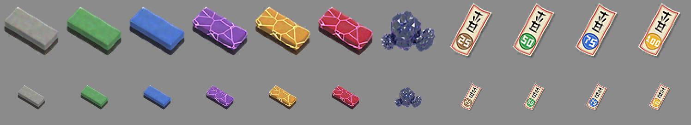

# Progressão das katanas

Toda katana sobe de **nível** abatendo inimigos, nasce com uma **estrela** sorteada e é **fortificada** na `/forja` de
+1 a +17 e depois até a **Ascensão**: a mesma escada das varas do AkashicFishing, com as regras de lâmina do
SlashBlade (abates, proud soul, desgaste, a curva de dano do refino).



*As seis pedras de afiar, o tamahagane e os quatro ofudas de proteção (`arte/itens/forja.py`), em 128 e em 64 px.*

## De onde vêm

| Origem | O que acontece |
|---|---|
| `/overkill dar <lâmina> [jogador] [estrela] [nível] [+N\|asc]` | Admin. Sem estrela, ela é sorteada como numa katana nova |

As katanas **não têm receita de bancada**. Por enquanto saem só por admin; a forma de obtê-las no jogo está em
aberto.

### A estrela

Sorteada **na primeira vez que a katana é empunhada** (uma katana dada sem estrela sorteia a sua quando alguém a
segura). Quem empunha primeiro fica como "Forjada por". Cada estrela é cinco vezes mais rara que a de
baixo:

| Estrela | Peso | Chance | Dano |
|---|---|---|---|
| Normal | 625 | 80,1% | ×1 |
| ★ Prata | 125 | 16,0% | ×1,1 |
| ★ Ouro | 25 | 3,2% | ×1,25 |
| ★ Irídio | 5 | 0,64% | ×1,5 |

A partir de ouro, o servidor anuncia (`progressao.anunciar_estrela_a_partir_de`).

## Nível 1 a 99

XP do nível `L` ao `L+1`: `20 + 1,37 · L^1,5` (a curva das varas; 54.732 XP até o 99). Um abate com a katana na mão
dá **metade da vida máxima** do alvo (um zumbi, 10), vezes `1 + 0,1 · nível do rank de concentração` (até ×1,6 no SSS),
de 1 a 400. Uns 4.500 zumbis até o 99.

O nível soma dano pela **curva do refino do SlashBlade**, com o nível no lugar dos refinos:
`(1 − 1/(1 + f·(nível − 1))) × dano base`, com `f = 0,05` (0,1 depois de **mil abates**, o "fio feroz" do SlashBlade).
É uma curva que cresce rápido no começo e nunca passa de +100%:

| Nível | Katana de Aço (base 4) | Com mil abates |
|---|---|---|
| 1 | 4 | 4 |
| 10 | 5,2 | 5,9 |
| 25 | 6,2 | 6,8 |
| 50 | 6,8 | 7,3 |
| 99 | 7,3 | 7,6 |

**Dano da katana** = `(base + o que o nível soma) × estrela × fortificação`. No combate, o golpe multiplica isso
(veja [COMBATE.md](COMBATE.md)) e o rank soma o seu bônus.

## Almas (proud soul), desgaste e reparo

Como no SlashBlade:

* Cada abate dá **almas**: `min(100, XP que o mob solta × (1 + 0,1 · nível do rank))`.
* Uma **Slash Art** custa **20 almas**; sem elas, sai assim mesmo e a katana leva 1 de desgaste.
* Cada golpe que acerta gasta **1 de durabilidade**, e cada bloco minerado com ela também.
* **Quebrada**, ela ainda corta, com um quarto do dano base e sem Slash Art.
* O **reparo** é na forja (a bigorna à esquerda): uma alma por 10 de desgaste, das almas da própria katana.

A fortificação multiplica a durabilidade também.

## A forja

`/forja` (também `/overkill forja`; permissão `overkill.forja`, liberada por padrão):

```
  .  [ofuda]  .   .  [pedra]  .   .   .   .
  . [katana]  ~   ~  [estado] ~   ~ [saída] .
[rep]   .   [  A P R I M O R A R  ]   .  [%]
```

| Onde | O quê |
|---|---|
| Katana | a katana que entra |
| Pedra | uma **pedra de afiar** (multiplica a chance) ou, depois do +17, o **tamahagane**. Opcional |
| Ofuda | um **ofuda de proteção** (segura a regressão). Opcional |
| Estado | o próximo nível (+7 → +8), o nível da katana exigido, o custo em níveis de XP, a chance, a regressão, o multiplicador de agora e o do próximo |
| Cano (`~`) | a chance, pela cor; na tentativa, conta até o número sorteado, desacelerando, e fica verde ou vermelho |
| APRIMORAR | os cinco espaços de baixo; cinza quando ainda não dá, e a dica diz o porquê |
| % | a maior das duas chances, a de sucesso em verde ou a de falha em vermelho |
| Bigorna | repara a katana pelas almas dela |

O custo e a pedra são pagos no clique; a katana sai na saída, tenha subido ou não. Fechar o baú no meio devolve tudo,
a tentativa já valendo.

### +1 a +17 e a Ascensão

A tabela das varas: do +5 em diante a chance cai em progressão geométrica, `0,5 · 0,653^(n−5)`, de 50% a 0,3%, e na
falha a katana **volta um nível** com chance igual à de sucesso.

| Nível | Nível da katana | Custo (níveis de XP) | Chance = regressão |
|---|---|---|---|
| +1 | 1 | 1 | 100% (sem regressão) |
| +2 | 1 | 1 | 95% (sem regressão) |
| +3 | 1 | 2 | 90% (sem regressão) |
| +4 | 1 | 2 | 85% (sem regressão) |
| +5 | 1 | 3 | 50% |
| +6 | 20 | 3 | 32,6% |
| +7 | 20 | 4 | 21,3% |
| +8 | 20 | 5 | 13,9% |
| +9 | 20 | 6 | 9,1% |
| +10 | 20 | 7 | 5,9% |
| +11 | 50 | 8 | 3,9% |
| +12 | 50 | 10 | 2,5% |
| +13 | 50 | 12 | 1,65% |
| +14 | 50 | 14 | 1,08% |
| +15 | 50 | 16 | 0,70% |
| +16 | 75 | 20 | 0,46% |
| +17 | 75 | 25 | 0,30% |
| **Ascensão** | 99 | 40 | 10% (sem regressão), e um tamahagane por tentativa |

Do +0 ao +17: umas **2.600 tentativas** sem ajuda e umas 390 com pedras míticas e ofudas de 100%. Cada nível
multiplica o dano e a durabilidade: `1 + 0,04 × N` (×1,68 no +17), e a Ascensão soma mais 0,5 (×2,18). A partir do
+10 o sucesso é anunciado (`progressao.anunciar_fortificacao_a_partir_de`).

### Pedras de afiar

Toishi de duas camadas, a de cima na cor do tier; dos épicos para cima, veios que brilham.

| Tier | Multiplica a chance |
|---|---|
| Comum | ×1,15 |
| Incomum | ×1,3 |
| Rara | ×1,5 |
| Épica | ×1,75 |
| Lendária | ×2 |
| Mítica | ×2,5 |

Multiplicam (até 95%), não somam: o +11 vai de 3,9% para 9,7% com a mítica. Uma por tentativa.

### Ofudas de proteção

Talismãs de papel com o selo do percentual: seguram a regressão de uma tentativa que falhou com 25%, 50%, 75% ou
100%. Só são gastos **quando seguram**. Não empilham (cada um tem um id próprio).

### Tamahagane

O aço-joia. Vai no espaço da pedra para a Ascensão e é gasto na tentativa.

### De onde caem

De inimigos abatidos com uma katana, junto do loot deles. O tier é o do inimigo, pela vida máxima: até 20 comum, até 40
incomum, até 80 raro, até 150 épico, até 300 lendário, acima disso (e os chefes, Wither e Dragão) mítico.

| Material | Chance por abate | Tier |
|---|---|---|
| Pedra de afiar | 0,25% | o do inimigo |
| Ofuda | 0,4% | 25% de comuns e incomuns, 50% de raros, 75% de épicos, 100% de lendários e míticos |
| Tamahagane | 0,5% de lendários, 3% de míticos | — (anunciado no servidor) |

Tudo em `config.yml`, `progressao.drops`.

**Com o AkashicFishing:** as pedras de fortificação, os selos de proteção e as pedras de ascensão da pesca também servem
na forja, com os mesmos tiers (`progressao.aceitar_itens_do_akashicfishing`).

Os materiais não entram em receitas da bancada, e as katanas também não (duas espadas na bancada viram uma espada
reparada do vanilla).

## No item

Dados persistentes (Künftig): `overkill:blade`, `xp`, `kills`, `proud_soul`, `fortificacao`, `estrela`, `wear`,
`criador`. O nome ("Katana Sakurajima ★ +7 [Nv. 45]") e a descrição são reescritos a partir deles. Durante uma luta as
mudanças ficam no servidor e vão para o item numa pausa (3 segundos sem acertar), ao subir de nível, ou no máximo a cada
10 segundos, e nunca com o botão direito segurado: mexer no item na mão faria o cliente soltar a carga da Slash Art e
mostrar o nome do item de novo sobre a hotbar.

## Admin

| Comando | O quê |
|---|---|
| `/overkill dar <lâmina> [jogador] [estrela] [nível] [+N\|asc]` | uma katana |
| `/overkill pedra <comum..mitica\|tamahagane> [quantidade] [jogador]` | pedras de afiar ou tamahagane |
| `/overkill ofuda <25\|50\|75\|100> [quantidade] [jogador]` | ofudas |

## Testado

No servidor (Crucible) com o cliente de testes: veja [TESTES.md](TESTES.md). A estrela, os abates, os drops, o
desgaste, o reparo e a forja (Shift+clique, botão, sorteio, saída) funcionaram.
