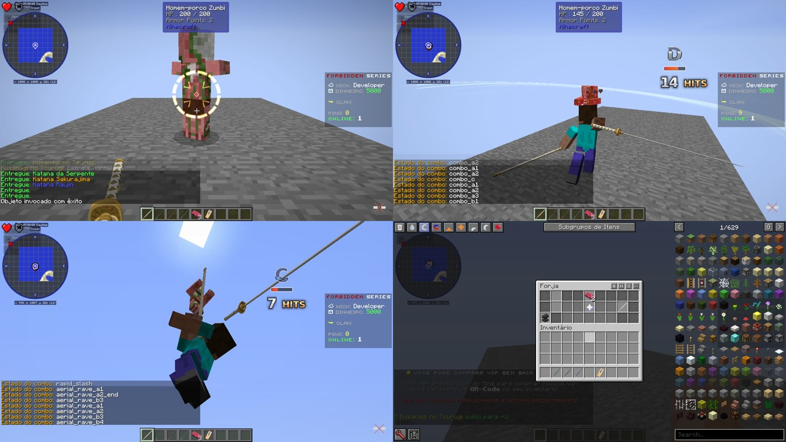
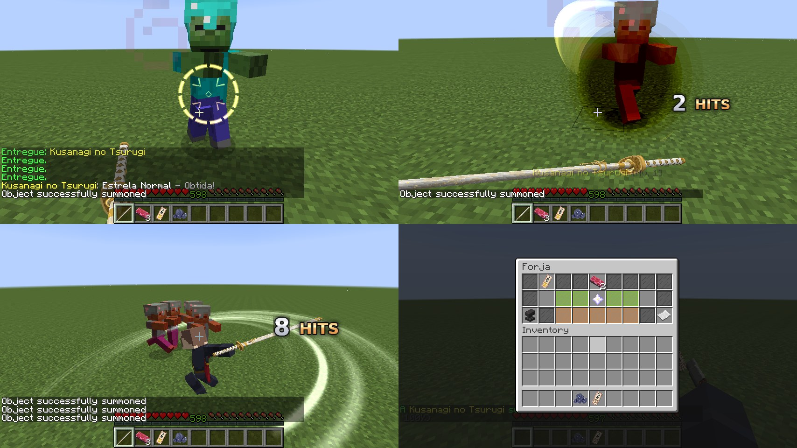

# Testes no servidor

## 2026-11-08: o Künftig mesclado com a linha do AkashicFishing (API 11)

A branch do Künftig feita para o Overkill (`claude/gifted-knuth-x0wf4k`) e a do AkashicFishing
(`claude/kind-ride-ts9apr`) saíram do mesmo ponto da `main` e as duas chamavam suas adições de "API 9". Elas foram
mescladas ([Akashiic/Kunftig#19](https://github.com/Akashiic/Kunftig/pull/19), commit `02d5d68`):

* **Versões:** a 9 e a 10 ficaram com o AkashicFishing (escala, ossos e deslize das exibições, trava de voo; alcance da
  boia). O que o Overkill usa virou a **API 11**: teclas, HUD, câmera, exibições que voam e giram, `ao_atacar`,
  lâminas, efeitos e `pushVelocity`.
* **O código do Overkill não muda:** ele confere `isAvailable()` de cada recurso, não o número da versão.
* **Protocolo das exibições unificado:** a operação `MOTION` passou de 5 para 7 (a 5 é a `SCALE` do AkashicFishing).
  Cliente e servidor precisam do Künftig mesclado; um cliente da branch antiga lê errado a rotação das exibições.
* **CI:** o `kunftigRef` aponta para a branch mesclada; depois do merge da Akashiic/Kunftig#19, aponte para a `main`.

**Teste** com o Künftig mesclado, no servidor enxuto (Crucible, UniMixins, lwjgl3ify, GeckoLib, Künftig), com o
Overkill e o AkashicFishing juntos, e o cliente de desenvolvimento rodando o roteiro `overkill`:

| O quê | Resultado |
|---|---|
| Künftig | API v11, todas as pontes (pesca, itens, partículas, jogadores, hologramas, varas 3D, exibições, entrada, tela, lâminas e efeitos) |
| Overkill compilado contra a API mesclada | ok (testes passando) |
| Combo A, C, B, upperslash, rapid slash | ok, acertando |
| Combo aéreo A e B, aerial cleave | ok |
| As quatro Slash Arts (Judgement Cut, Onda, Corte Circular, Fio da Tempestade) | ok, cada uma tirando vida |
| Alvo (PigZombie com 200 de vida) | 200 → 3,9 ao longo do roteiro |
| Mira do lock-on, HUD do rank (C), contador de golpes (28 hits) | ok |
| Forja | ok (+1) |
| O boss do AkashicFishing no mesmo Künftig | ok (escala, trava de voo, golpes, Ciranda) |

Na cópia de teste, `spawn-monsters` precisava estar ligado e a dificuldade acima de pacífica: com
`spawn-monsters=false`, o Crucible não deixa nem o `/summon` criar o PigZombie, e o roteiro roda sem alvo.

## 2026-11-08: o cliente do modpack TEOF 5.1 no servidor do TEOF

O cliente completo do pack (`TEOF-5.1-MANUAL.zip`: Forge 1614, 215 mods, Angelica, NecroTempus, Backhand) rodando
aqui sem tela (Xvfb, Java 8), com o roteiro `overkill` do Künftig no lugar do Künftig do pack, entrando na cópia
isolada do servidor completo.

| O quê | Resultado |
|---|---|
| Entrar no servidor | ok, depois de alinhar os mods (abaixo) |
| Combo A, C (clique no fim do A2), B (clique no fim do A3) | ok, acertando o alvo (200 → 133 só nos três) |
| Upperslash, rapid slash | ok |
| Combo aéreo A1 → A2 → B3 → **B4**, aerial cleave até o pouso | ok, acertando |
| Slash Arts: Judgement Cut, Corte Circular, Wave Edge | ok; a Onda Vertical saiu numa rodada e não na outra (o tempo do roteiro no cliente lento) |
| Mira do lock-on, contador de golpes, HUD do rank (D → C), esfera do Judgement Cut | ok, desenhados com o Angelica |
| Forja | ok (+1) |

### O que o servidor precisa para o pack 5.1 entrar

Sem isto, o cliente do pack é recusado ou expulso:

| O quê | Por quê |
|---|---|
| **AkashicBellow 0.1.0-beta.7** e **VitaGenesis 0.1.0-beta.7** em `mods/` | o cliente recusa um servidor sem o AkashicBellow ("Rejecting connection SERVER: akashicbellow") |
| **BaublesExpanded 2.2.26** (em `mods/1.7.10/`), **Omni Pipes** do pack, **Mirai 1.0-BETA** no lugar do Horizons of The Mirai 0.1.19 | o FML recusa versões diferentes ("Mod rejections") |
| AE2 rv3-1093, Et Futurum 2.6.64, Hodgepodge 2.7.219, GTNHLib 0.11.54, Eln 1.24.8, adventurebackpack 1.4.28, AM2 CR23 + AM2PlayGround, ATM-Family 71db724, akashicmixer 01be1dc | as versões do pack |
| **CastleOfStone**: liberar o `akashicthepatcher` | o anti-cheat expulsa quem tem o `!Akashic-ThePatcher-...HeldItemCullBox.jar`, que vem no próprio pack |
| Künftig desta branch (API 9 com `pushVelocity`), Overkill, AkashicFishing | o Overkill pede a API 9 |

Na cópia de teste também foram desligados o modo BungeeCord do `spigot.yml` e o ProtocolObelisk (as conexões vinham
direto, sem o Velocity), e o jogador de teste ("Developer") estava banido no `banned-players.json` de produção.

### Achados e correções

* **A flutuação do combo aéreo chegava aos trancos.** O `setVelocity` do Bukkit só sai na atualização do rastreador
  (a cada 2 ticks), e o vy medido pela diferença de posição alternava entre 0 e o dobro (as posições do cliente chegam
  fora de fase com os ticks), então a regra do SlashBlade (age só com vy < 0) pulava um tick sim, outro não. Agora o
  Künftig manda o movimento no mesmo tick (`KunftigPlayers.pushVelocity`) e o Overkill prevê o vy como o cliente
  calcula. Conferido com o log `depuracao: true`: o jogador paira no A1-A2 e o B3 lança a 0,6.
* **As janelas do combo B são de ~3 ticks** (as do SlashBlade). Com ping ou quedas de FPS, a rajada pode parar no
  meio; é fiel ao original, mas um "buffer" de clique (como o DmC) deixaria mais tolerante.

## 2026-11-07: servidor do TEOF (Crucible) e servidor enxuto

Os arquivos do servidor de produção (Crucible `1.7.10-staging-67b53034`, Java 21, 215 mods, 63 plugins), com o
Künftig da branch (API 9), o Overkill e o AkashicFishing 1.4.0 compilados na hora. Cópia isolada: DiscordSRV, LiteBans,
PixCraft e BungeeGuard fora, LuckPerms em H2 em vez do MySQL.

### 1. Servidor completo

| O quê | Resultado |
|---|---|
| Boot com os 215 mods e os plugins | **ok**, `Done (89s)` com 10 GB de heap e um mundo novo |
| Künftig | todas as APIs habilitadas (pesca, itens, partículas, entrada, tela, lâminas e efeitos) |
| Overkill | habilitado, 5 lâminas; recebe o canal `kunftig:input` |
| AkashicFishing | habilitado; vê o Künftig API v9 e o NecroTempus |
| `/overkill`, `/overkill recarregar` pelo console | ok |
| Desligar | os dois plugins desabilitam sem erro |

O servidor do pacote não tinha o Künftig nem o AkashicFishing: os dois precisam entrar em `mods/` e `plugins/`.

Ao rodar o servidor sem terminal (em segundo plano), o leitor de console do Crucible lê "linha vazia" sem parar e
enche a memória de comandos (117 milhões de `ServerCommand`, 10 GB em minutos). Não é dos mods: com um console de
verdade (ou um pipe na entrada padrão) não acontece. Fica o aviso para quem roda o servidor por script.

### 2. Servidor enxuto + cliente de testes

O mesmo Crucible com só UniMixins, lwjgl3ify, GeckoLib e Künftig, o Overkill com os drops a 100%, e o cliente de
desenvolvimento do Künftig rodando o roteiro `overkill` (`OverkillServerHarness`): entra, pega a Kusanagi, trava num
zumbi, faz o combo, a Slash Art, mata, e usa a forja, registrando chat, descrição do item e vida dos alvos.

| O quê | Resultado |
|---|---|
| Estrela sorteada ao empunhar | ok ("Kusanagi no Tsurugi: ★ Estrela Prata - Obtida!") e "Forjada por" |
| Lock-on (Sneak) | ok: mira dourada com o anel de vida no zumbi, câmera puxada |
| Combo (cliques direitos) | ok: 20 → 17,5 → 15,1 → 12,6 de vida; arco do corte; contador "1 HITS" ... "8 HITS" |
| Carga e Slash Art | ok: a katana sai da bainha, Judgement Cut no alvo travado (10,1 → 5,7) |
| Abates | ok: nível 1 → 3, almas, pedras e ofudas no tier do zumbi (comum, 25%) |
| Desgaste e reparo | ok: 1463/1500 depois da luta; o reparo custou 4 almas |
| Forja | ok: Shift+clique da katana, da pedra e do ofuda; APRIMORAR; o cano conta até o sorteio; "+1" na saída; a pedra gasta, o ofuda guardado (não houve regressão); o reparo |

### Achados e correções

* **`KunftigInput.bind` recusava `teclas`** (a API validava só as ações): a exceção no tick parava o combate de todos.
  Corrigido no Künftig (com teste) e o Overkill ficou resiliente: o erro de um jogador é logado uma vez e o resto segue,
  e se um Künftig antigo recusar as teclas, liga só a tecla especial.
* **O nome do item piscava sobre a hotbar durante a luta**: cada gravação dos dados na katana faz o cliente mostrar o
  nome de novo. Agora a gravação espera uma pausa na luta (3 segundos sem acertar), sobe de nível na hora, e no máximo
  a cada 10 segundos.

### A verificar

* Com o cliente completo do modpack (o cliente de testes só tem o Künftig): Backhand, Angelica, NecroTempus.
* A Slash Art das outras katanas (ondas, corte circular, wave edge) e o combo B e aéreo, que o roteiro ainda não faz.
* Vários jogadores ao mesmo tempo e o PvP.
